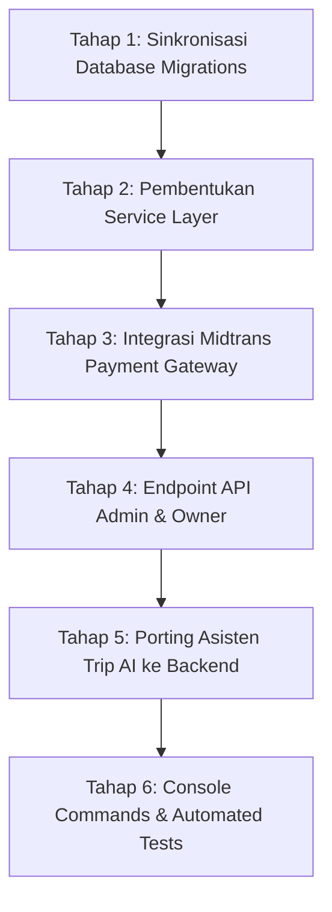

# Catatan Progres & Analisis Kebutuhan Backend
## Sistem Informasi Sewa dan Penjualan Perlengkapan Outdoor — Annapurna Adventure
**Referensi:** Dokumen Teknis (Technical Specification) Versi 1.0 (2 Oktober 2026)  
**Terakhir Diperbarui:** 15 Oktober 2026 (lihat Bagian B untuk kebutuhan backend dari revisi frontend 9–15 Oktober 2026)  

---

## 1. Ringkasan Status Proyek

Aplikasi **Annapurna Adventure** saat ini telah memiliki antarmuka (UI/UX) berbasis Blade + Vanilla CSS + JavaScript yang **100% presisi dan sangat matang** sesuai dengan Dokumen Teknis Bab 10. Logika bisnis sewa, perhitungan denda, alur checkout, aturan sistem pakar Asisten Trip, dan simulasi operasional admin/owner telah berjalan dengan baik di sisi klien (frontend / `public/assets/js/`).

Namun, arsitektur backend Laravel saat ini masih bersifat **fondasi / hybrid**:
- Sebagian besar data operasional masih disimpan di state klien (`data.js` / localStorage).
- Backend Laravel baru memuat migrasi 15 tabel dasar dari total 32 tabel di dokumen teknis.
- Lapisan `app/Services/` dan integrasi SDK Midtrans belum diimplementasikan di server.

File catatan ini merangkum perbandingan detail komponen per komponen serta peta jalan (*roadmap*) pengembangan backend agar sistem **100% sesuai dengan Dokumen Teknis**.

---

## 2. Matriks Kesesuaian Komponen (Dokumen Teknis vs Kode Saat Ini)

| Bab Dokumen | Deskripsi Komponen | Status Saat Ini | Keterangan |
| :--- | :--- | :---: | :--- |
| **Bab 1 & 2** | Stack Teknologi (PHP 8.2, Laravel 12, MySQL 8, Dompdf, Excel) | ⚠️ **Sebagian** | Core Laravel 12, Dompdf, Excel sudah terpasang di `composer.json`. Paket `midtrans/midtrans-php` belum diinstal. |
| **Bab 2.4** | Autentikasi & Otorisasi (`EnsureRole`, Session, Bcrypt) | ✅ **Sesuai** | Guard web, proteksi role `admin` & `owner`, auto-logout saat staff dinonaktifkan sudah berjalan di [EnsureRole.php](file:///d:/KULIAH%20SEMESTER%207/IUM%20COMPRO%20PROECT/Annapurna/annapurna/app/Http/Middleware/EnsureRole.php). |
| **Bab 2.7** | Scheduler & Queue Jobs (`bookings:expire-unpaid`, dsb.) | ❌ **Belum Ada** | Belum ada scheduled commands di `app/Console/Commands` atau [console.php](file:///d:/KULIAH%20SEMESTER%207/IUM%20COMPRO%20PROECT/Annapurna/annapurna/routes/console.php). |
| **Bab 3 & 4** | Kebutuhan Sistem & 22 Use Case (UC-01 s/d UC-22) | ⚠️ **Sebagian** | UI dan simulasi lengkap; integrasi penuh database di backend masih perlu disambungkan. |
| **Bab 3 (NF-02)** | Audit Trail Hash Chain SHA-256 (`activity_logs`) | ✅ **100% Sesuai** | Model [ActivityLog.php](file:///d:/KULIAH%20SEMESTER%207/IUM%20COMPRO%20PROECT/Annapurna/annapurna/app/Models/ActivityLog.php) dan [Audit.php](file:///d:/KULIAH%20SEMESTER%207/IUM%20COMPRO%20PROECT/Annapurna/annapurna/app/Support/Audit.php) sudah memiliki append-only, genesis 64 nol, dan fungsi verifikasi `firstBrokenId()`. |
| **Bab 5** | Siklus Status & Formula Bisnis (DP 50%, denda lewat jam 22.00, refund H-2) | ✅ **Sesuai** | Logika perhitungan dan enum status sudah sesuai di rule sistem dan [ApiController.php](file:///d:/KULIAH%20SEMESTER%207/IUM%20COMPRO%20PROECT/Annapurna/annapurna/app/Http/Controllers/Annapurna/ApiController.php). |
| **Bab 6 & 7** | ERD & Kamus Data (32 Tabel Database) | ⚠️ **Perlu Penyesuaian** | Baru ada 15 tabel migrasi bisnis di backend. 17 tabel pendukung belum dimigrasikan. |
| **Bab 8.1** | Service Layer Backend (`app/Services/`) | ❌ **Belum Ada** | Belum ada direktori `app/Services/`. Logika bisnis masih berada di frontend dan controller. |
| **Bab 9** | Route & Endpoint API | ⚠️ **Sebagian** | Route halaman web lengkap. Endpoint backend untuk panel Admin & Owner (`/api/admin/*`, `/api/owner/*`) belum dibuat. |
| **Bab 10** | Desain UI/UX & CSS Design Tokens | ✅ **100% Sesuai** | Seluruh variabel warna (`--g950`, `--g700`, `--gold`, `--cream`, dll.), font `Figtree`, dan `Kaushan Script` presisi di [style.css](file:///d:/KULIAH%20SEMESTER%207/IUM%20COMPRO%20PROECT/Annapurna/annapurna/public/assets/css/style.css). |
| **Bab 11** | Asisten Trip AI (NLP & Forward-Chaining) | ⚠️ **Jalan di Klien** | 100% sesuai aturan dokumen di [ai.js](file:///d:/KULIAH%20SEMESTER%207/IUM%20COMPRO%20PROECT/Annapurna/annapurna/public/assets/js/ai.js). Belum memiliki endpoint backend `POST /api/ai/plan` dan `POST /api/chat`. |
| **Bab 12** | Integrasi Midtrans Snap & Webhook | ❌ **Belum Ada** | Belum ada pembuatan Snap token, webhook endpoint, dan verifikasi SHA-512 signature di server. |
| **Bab 13** | Database Seeder & Akun Bawaan | ✅ **100% Sesuai** | Akun default (owner, dita, customer) persis sesuai di [DatabaseSeeder.php](file:///d:/KULIAH%20SEMESTER%207/IUM%20COMPRO%20PROECT/Annapurna/annapurna/database/seeders/DatabaseSeeder.php). |
| **Bab 14** | Skenario Pengujian Black Box | ⚠️ **Belum Otomatis** | Belum ada berkas automated test di `tests/Feature/` dan `tests/Unit/`. |

---

## 3. Rincian Kesenjangan (*Gaps*) yang Perlu Dilengkapi

### 3.1. Database & Migrasi (Bab 6 & 7)
Total tabel pada dokumen teknis adalah **32 tabel** (+1 `payment_logs` = 33 tabel). Saat ini migrasi baru mendefinisikan 15 tabel bisnis.

#### Tabel yang Perlu Dibuat:
1. `product_variants`: Relasi varian ukuran ke produk (saat ini masih tersimpan sebagai JSON `variant_data` di `products`).
2. `booking_item_units`: Pivot nomor unit fisik barang yang diserahterimakan saat sewa keluar.
3. `attributes` & `attribute_category`: Master data atribut filter barang.
4. `unit_logs`: Riwayat status per unit fisik (keluar, kembali, cuci, perbaikan).
5. `booking_changes`: Tabel pengajuan ganti barang oleh penyewa.
6. `booking_extensions`: Tabel pengajuan perpanjangan sewa (maks. 14 hari).
7. `booking_histories`: Linimasa perjalanan rental per booking.
8. `refunds`: Pencatatan refund pembatalan, nominal, dan rekening tujuan.
9. `review_products`: Relasi N:M ulasan ke banyak barang.
10. `customer_notes`: Catatan flag pelanggan oleh Owner (`normal`, `jaminan`, `blacklist`).
11. `sops`: Standar Operasional Prosedur staff toko.
12. `login_codes`: Kode OTP login sekali pakai (masa berlaku 10 menit).
13. `monthly_archives`: Rekap bulanan periode YYYY-MM untuk Google Drive.
14. `payment_logs`: Penyimpanan mentah payload webhook Midtrans dan hasil verifikasi signature.
15. Pemisahan `expenses` dan `incomes` (saat ini digabung dalam tabel `finances`).

#### Penyesuaian Kolom pada Tabel yang Sudah Ada:
* **`bookings`**:
  - Dokumen menspesifikasikan Primary Key berupa `VARCHAR(20)` dengan format kode `RNT-1001` (bukan big integer auto-increment).
  - Penambahan kolom: `out_at`, `out_cond`, `out_by`, `return_at`, `return_cond`, `late_days`, `damage_fee`, `return_by`, `cancel_at`, `cancel_reason`.
* **`products`**:
  - Kolom harga jual di dokumen adalah `sell_price`, saat ini bernama `sale_price`.
  - Kolom `service_every` (siklus servis per n kali sewa) perlu ditambahkan.
* **`payments`**:
  - Dokumen menggunakan relasi polimorfik (`payable_type`, `payable_id`) untuk menghubungkan rental atau penjualan.
  - Penambahan kolom gateway Midtrans: `gateway`, `gateway_order_id`, `snap_token`, `snap_redirect_url`, `gateway_transaction_id`, `payment_type`, `va_number`, `gateway_status`, `fraud_status`, `expired_at`.

---

### 3.2. Lapisan Service Backend (`app/Services/`) (Bab 8.1)
Dokumen merinci 17 kelas Service yang perlu diimplementasikan:
1. **`AvailabilityService`**: Menghitung ketersediaan unit fisik per rentang tanggal per produk, per ukuran, dan per paket sewa dengan `lockForUpdate`.
2. **`PricingService`**: Menghitung lama sewa, subtotal, DP (default 50%), hari keterlambatan, dan denda (mode persen / nominal).
3. **`PromoService`**: Validasi kuota promo, minimal order, periode aktif, dan pengurangan kuota.
4. **`BookingService`**: Alur pembuatan rental, pembatalan, perpanjangan, dan penggantian barang.
5. **`PaymentService`**: Upload bukti transfer, verifikasi admin, penolakan, pelunasan di toko.
6. **`RentalService`**: Pencatatan serah terima barang keluar (pilih unit) dan barang kembali (cek kondisi, denda).
7. **`UnitService`**: Manajemen status unit inventaris fisik, pencatatan servis / cuci berkala.
8. **`SaleService`**: Alur transaksi pembelian barang toko dan pengurangan stok.
9. **`RefundService`**: Kalkulasi hak refund (≥ H-2 dapat 100%, < H-2 hangus) dan pemrosesan transfer.
10. **`FinanceService`**: Pencatatan kas masuk, kas keluar, rekap saldo, dan pembatalan transaksi (*void*).
11. **`ReportService`**: Pembuatan laporan rental, penjualan, keuangan, serta ekspor PDF & Excel.
12. **`ArchiveService`**: Rekap bulanan otomatis dan integrasi Google Drive API.
13. **`StaffService`**: Tambah akun staff, reset password sementara, kirim email undangan.
14. **`ChatbotService`**: Menjawab pertanyaan FAQ berdasarkan konfigurasi toko (`settings`).
15. **`TripPlannerService`**: Ekstraksi entitas teks bebas dan penyusunan rekomendasi alat / paket (porting dari `ai.js`).
16. **`InsightService`**: Analitik ulasan pelanggan, rekomendasi barang sering disewa bersama, ringkasan laporan.
17. **`ForecastService`**: Prediksi kebutuhan unit barang 14 hari ke depan berdasarkan data historis sewa.

---

### 3.3. Integrasi Midtrans Payment Gateway (Bab 12)
Fitur yang harus disiapkan:
1. **Instalasi:** `composer require midtrans/midtrans-php`.
2. **Konfigurasi (.env & config/midtrans.php):**
   - `MIDTRANS_MERCHANT_ID`
   - `MIDTRANS_SERVER_KEY`
   - `MIDTRANS_CLIENT_KEY`
   - `MIDTRANS_IS_PRODUCTION` (default `false`)
   - `MIDTRANS_DP_EXPIRY_MINUTES` (default `60`)
3. **`MidtransService`:**
   - Pembuatan Snap Token (`createSnap()`).
   - Cek status transaksi Midtrans (`status()`).
   - Pembatalan transaksi belum bayar (`cancel()`).
   - Verifikasi Signature SHA-512: `hash('sha512', $order_id . $status_code . $gross_amount . $server_key)`.
4. **Endpoint & Webhook:**
   - `POST /api/bookings/{id}/pay` (membuat Snap token untuk pop-up checkout).
   - `POST /api/payments/midtrans/notification` (webhook penerima notifikasi otomatis, bebas CSRF).
   - Penanganan idempoten dengan `lockForUpdate`.
   - Update otomatis status booking ke `dikonfirmasi` saat status Midtrans `settlement` / `capture accept`.

---

### 3.4. Scheduler & Queue Jobs (Bab 2.7)
Perintah Artisan yang perlu dibuat:
* `php artisan bookings:expire-unpaid`: Menghapus/membatalkan booking tanpa bukti DP melewati batas waktu 60 menit (tiap 15 menit).
* `php artisan rentals:return-reminder`: Kirim notifikasi pengingat ke penyewa yang jadwal kembalinya hari ini (tiap hari jam 08.00).
* `php artisan rentals:mark-overdue`: Menandai rental yang belum kembali lewat jam 22.00 (jam tutup toko) dan menghitung denda per malam (tiap hari jam 00.05).
* `php artisan reports:monthly-archive`: Membuat arsip PDF/Excel bulanan dan unggah ke Google Drive (tanggal 1 jam 06.00).

---

## 4. Peta Jalan Implementasi Backend (Roadmap)

Tahapan pengerjaan yang disarankan saat melanjutkan pengembangan:



1. **Tahap 1: Sinkronisasi Database Migrations**
   - Buat migrasi untuk sisa tabel (variants, units pivot, changes, extensions, refunds, payment_logs, dll.).
   - Perbarui model Eloquent dengan relasi yang sesuai Dokumen Teknis Bab 6.1.
2. **Tahap 2: Pembentukan Service Layer**
   - Buat folder `app/Services/` dan implementasikan service utama: `AvailabilityService`, `PricingService`, `BookingService`, `PaymentService`, `RentalService`.
3. **Tahap 3: Integrasi Midtrans Payment Gateway**
   - Install SDK Midtrans, buat `MidtransService`, dan webhook notification handler dengan validasi signature SHA-512.
4. **Tahap 4: Endpoint API Admin & Owner**
   - Buat controller untuk route `/api/admin/*` dan `/api/owner/*`.
   - Hubungkan tombol aksi pada modal di `admin.js` agar memanggil backend endpoint via `fetch()`.
5. **Tahap 5: Porting Asisten Trip AI ke Backend**
   - Pindahkan logika dari `ai.js` ke `TripPlannerService` dan `ChatbotService` dengan endpoint `POST /api/ai/plan` dan `POST /api/chat`.
6. **Tahap 6: Scheduled Jobs & Automated Tests**
   - Buat console commands di `routes/console.php`.
   - Tulis unit/feature test untuk skenario T-01 s/d T-14 dan MT-01 s/d MT-07 di folder `tests/`.

---

## 5. Kredensial Akun Pengujian Default

Akun yang sudah terpasang dan aktif di [DatabaseSeeder.php](file:///d:/KULIAH%20SEMESTER%207/IUM%20COMPRO%20PROECT/Annapurna/annapurna/database/seeders/DatabaseSeeder.php):
* **Owner:** `owner@annapurna.id` / `owner123`
* **Admin / Staff:** `dita@annapurna.id` / `dita123`
* **Customer:** `customer@annapurna.id` / `customer123`

---

## 6. Pembaruan 8 Oktober 2026 — Aturan FE disesuaikan dengan price list WhatsApp

Sumber: 12 poster price list & syarat ketentuan Annapurna Adventure (WhatsApp).

* **Tarif sewa bertingkat:** setiap barang/paket punya 3 tarif — `rent` (per malam), `rent3` (perkegiatan 3 hari 3 malam), `rent5` (ekspedisi 5 hari 5 malam). Paket memakai `price`, `price3`, `price5`.
  Lama sewa lain dihitung dari kombinasi tarif termurah (`Rules.tierPlan` di `data.js`), mis. 4 malam = perkegiatan + 1 malam.
  Setiap baris booking menyimpan `tiers` ({ d1, d3, d5 }) saat checkout agar harga tidak berubah bila price list diubah.
* **Paket Tektok** (Standar Rp60.000, Premium Rp110.000) hanya punya harga 1 malam; untuk 3 / 5 hari dihitung dari harga satuan isinya.
* **Batas pengembalian:** tanggal kembali pukul 22.00 WIB (jam tutup toko). Lewat dari itu = terlambat; denda = tarif per malam × jumlah barang × malam keterlambatan.
* **Kategori:** Tenda, Tas Backpack / Rucksack, Footwear, Fashion, Outdoor Equipment, Cooking Equipment (53 barang sewa).
* **Barang jual:** price list tidak memuat barang jual. Hanya Gas Kaleng (isi Paket BBQ) yang dijual, harga Rp18.000 masih perlu dikonfirmasi.
* **Belum disesuaikan:** `database/seeders/AnnapurnaSeeder.php` dan tabel `products` / `packages` di backend masih memakai katalog lama & satu kolom harga sewa. Perlu kolom `rent_price_3`, `rent_price_5` (produk) dan `price_3`, `price_5` (paket) saat backend disambungkan.

---
---

# BAGIAN B — Kebutuhan Backend dari Revisi Frontend (9–15 Oktober 2026)

> **Untuk siapa:** developer backend yang menyambungkan frontend ke Laravel + MySQL.
> **Prinsip:** seluruh aturan bisnis di bawah **sudah berjalan di frontend** (`public/assets/js/`, data di `localStorage`). Tugas backend adalah **memindahkan data & aturan yang sama ke server** supaya data tidak hilang saat browser dibersihkan, bisa dipakai bersama banyak perangkat, dan tidak bisa dimanipulasi dari browser.
> **Acuan perilaku:** bila ragu, ikuti perilaku frontend. File acuan disebut di setiap bagian.

## B.0 Ringkasan & Prioritas

| No | Fitur | Status FE | Yang harus dikerjakan backend | Prioritas |
|---|---|---|---|---|
| 1 | Manajemen staff, reset kata sandi & email | Simulasi di browser | API staff + kirim email sungguhan + wajib ganti sandi di server | **P1 (kritis)** |
| 2 | Checkout tamu langsung ke pembayaran | Memakai `POST /daftar` | Pastikan register mengembalikan JSON & login session; rate limit | P1 |
| 3 | Penomoran nota `RNTL/` `DRY/` `ODR/` | Di browser | Nomor urut per bulan yang aman dari tabrakan | P1 |
| 4 | Pesanan belum dibayar tidak tampil di admin | Filter di browser | Query scope + scheduler batal otomatis | P1 |
| 5 | Layanan antar & jasa tenda + ongkir di nota | Di browser | Tabel layanan, pembayaran layanan, endpoint ubah layanan & perbarui nota | P2 |
| 6 | Laundry (kasir, status, struk, WA) | Di browser | Tabel & endpoint laundry, nomor DRY | P2 |
| 7 | Logika keuangan (lini, laba, refund, HPP) | Di browser | Kolom lini, perhitungan laba di server, laporan | P2 |
| 8 | Harga beli & restock | Di browser | Kolom harga beli, snapshot di item jual, tabel restock | P2 |
| 9 | Laporan berbagian & ekspor | Ekspor di browser | Endpoint data laporan (ekspor server opsional) | P3 |
| 10 | Pengaturan baru (tarif jasa, laundry, struk) | `settings` di browser | Simpan di tabel `settings` | P2 |
| 11 | Kotak keluar email & pembersihan data | Simulasi di browser | Tabel `email_logs`, arsip & pembersihan di server | P3 |
| 12 | Scheduler pengingat antar/jemput | Notifikasi di browser | Command terjadwal + notifikasi | P3 |

Urutan kerja yang disarankan ada di **B.14**.

---

## B.1 Manajemen Staff, Reset Kata Sandi & Email (P1 — KRITIS)

### Masalah saat ini (hasil uji)
| Bagian | Kondisi |
|---|---|
| Tambah / ubah / nonaktifkan / reset sandi staff (`owner/staff.js` → `DB.addStaff`, `DB.resetStaffPassword` dan fungsi staff lain di `data.js`) | Hanya mengubah `localStorage` |
| Login (`AuthController@login`) | Dicek dari **database** → **kata sandi lama tetap bisa dipakai**, staff baru dari panel **tidak bisa login**, staff yang "dinonaktifkan" di panel **masih bisa login** |
| Email (`DB.sendMail`) | Simulasi, hanya tercatat di "Kotak keluar" browser. `.env` masih `MAIL_MAILER=log` |
| `app/Mail/StaffAccountCreated.php` + `resources/views/emails/staff-account-created.blade.php` | Sudah ada, **belum pernah dipanggil** |
| Wajib ganti sandi saat login pertama (`forcePassword()` di `admin.js`) | Hanya di browser; server tidak menyimpan sandi baru |

### Endpoint yang dibutuhkan (middleware `auth` + `role:owner`)
| Method & URL | Fungsi | Body | Respons |
|---|---|---|---|
| `GET /api/owner/staff` | Daftar staff (owner & admin) | – | `[{id,name,email,phone,role,status,must_change_password,last_login_at,last_logout_at,created_by,created_at,activity_count}]` |
| `POST /api/owner/staff` | Tambah staff | `name, email (unique), phone, role: admin\|owner, send_email: bool` | `{user, temp_password, mail: {status, error?}}` |
| `PATCH /api/owner/staff/{id}` | Ubah nama/telepon/role | `name, phone, role` | `{user}` |
| `POST /api/owner/staff/{id}/toggle` | Aktif ↔ nonaktif | `reason?` | `{user}` |
| `POST /api/owner/staff/{id}/reset-password` | Reset sandi sementara | – | `{temp_password, mail: {status, error?}}` |
| `POST /api/akun/ganti-sandi` (semua user login) | Ganti sandi (termasuk wajib ganti) | `current_password` (boleh kosong bila `must_change_password=true`), `password`, `password_confirmation` | `{ok}` |

### Aturan
1. **Kata sandi sementara**: 10 karakter acak (huruf besar, kecil, angka), disimpan dengan `Hash::make()`, `must_change_password = true`.
2. **Reset sandi** wajib **langsung membatalkan** kata sandi lama dan **mengeluarkan semua sesi** staff tsb.:
   `DB::table('sessions')->where('user_id', $id)->delete();` + regenerate `remember_token`.
3. **Nonaktifkan**: `status = nonaktif`, hapus sesinya (logout paksa). Login sudah menolak status nonaktif (`AuthController` baris ±27) — pertahankan.
4. Owner **tidak boleh** menonaktifkan / reset dirinya sendiri, dan harus selalu ada minimal 1 owner aktif.
5. **Wajib ganti sandi di server**: middleware baru `EnsurePasswordChanged` — bila `must_change_password = true`, semua request panel selain `/api/akun/ganti-sandi` & logout dibalas `403 {code:'MUST_CHANGE_PASSWORD'}`. Frontend sudah menampilkan pop-up ganti sandi (`admin.js` `forcePassword()`), tinggal arahkan tombol simpannya ke endpoint ini.
6. Setiap aksi dicatat ke `activity_logs` lewat `App\Support\Audit` (tipe `staff`), **tanpa** menyimpan kata sandi.
7. Rate limit: `reset-password` maks. 5×/jam per staff.

### Email
- Buat Mailable kedua: `StaffPasswordReset` (subjek: *Kata sandi sementara akun Staff Annapurna Adventure*), view `emails/staff-password-reset.blade.php` (isi sama dengan pratinjau di `Reports.mailModal` FE: nama, email, role, kata sandi sementara, tombol masuk, peringatan wajib ganti).
- Kirim lewat queue: `Mail::to($user)->queue(new StaffAccountCreated(...))` / `StaffPasswordReset(...)`.
- **Bila email gagal**, API tetap sukses dan mengembalikan `temp_password` + `mail.status = 'gagal'` supaya Owner bisa menyampaikannya lewat WhatsApp (FE sudah punya modal "kirim manual").
- Catat setiap email ke tabel `email_logs` (lihat B.11) → dipakai halaman **Google Drive & Email → Kotak keluar** (10 per halaman).

### Konfigurasi `.env` (contoh Gmail)
```
MAIL_MAILER=smtp
MAIL_HOST=smtp.gmail.com
MAIL_PORT=587
MAIL_ENCRYPTION=tls
MAIL_USERNAME=annapurnaadv@gmail.com
MAIL_PASSWORD=xxxx xxxx xxxx xxxx   # App Password 16 karakter, BUKAN sandi Gmail biasa
MAIL_FROM_ADDRESS=annapurnaadv@gmail.com
MAIL_FROM_NAME="Annapurna Adventure"
QUEUE_CONNECTION=database
```
App Password dibuat di Akun Google → Keamanan → Verifikasi 2 langkah (aktifkan) → Sandi aplikasi. Jalankan worker: `php artisan queue:work`.

### Kriteria selesai (wajib lolos)
- [ ] Reset sandi Dita → login dengan sandi lama **gagal**, dengan sandi sementara **berhasil** lalu dipaksa ganti sandi.
- [ ] Staff baru dari panel bisa login dan menerima email.
- [ ] Staff dinonaktifkan → sesi aktifnya langsung keluar, login ditolak.
- [ ] Email gagal (mis. SMTP salah) → Owner tetap mendapat kata sandi sementara di layar.

---

## B.2 Checkout Tamu Langsung ke Pembayaran (P1)

**FE:** `pages/checkout.js` — bila customer belum login, FE memanggil `POST /daftar` dengan `{name, email, phone, password: <acak>}` lalu `DB.adoptSession(raw.user)` dan langsung ke `pembayaran?ids=…`. Bila server mengembalikan error `email` (sudah terdaftar) → FE menampilkan pop-up "masuk dulu".

Yang harus dipastikan backend:
1. `AuthController@register` saat `wantsJson()` mengembalikan `{ok:true, user:{name,email,phone,role,status,mustChangePw}}` **dan** sudah `Auth::login()` (session aktif) — sekarang sudah begitu, **jangan diubah formatnya**.
2. Validasi error dikembalikan sebagai `422 {errors:{email:[…]}}`.
3. Tambah kolom `users.auto_created` (bool) → akun dari checkout. Kirim email "Atur kata sandi" (link reset Laravel bawaan `password_reset_tokens`) supaya customer bisa login lagi nanti.
4. Cek **blacklist** customer di server (lihat `customer_notes` flag `blacklist`) sebelum membuat akun/booking.
5. Rate limit `POST /daftar`: 10/menit per IP.

---

## B.3 Penomoran Nota (P1)

| Dokumen | Format | Contoh | Reset nomor urut |
|---|---|---|---|
| Sewa | `RNTL/{urut 3 digit}/{bulan Romawi}/{tahun}` | `RNTL/015/X/2026` | setiap bulan |
| Penjualan | `ODR/{urut}/{bulan}/{tahun}` | `ODR/006/X/2026` | setiap bulan |
| Laundry | `DRY/{urut}/{bulan}/{tahun}` | `DRY/004/X/2026` | setiap bulan |

- Bulan Romawi: I…XII, berdasarkan **tanggal transaksi dibuat** (zona `Asia/Jakarta`).
- Buat tabel `document_sequences (prefix, year, month, last_number, PRIMARY(prefix,year,month))` dan ambil nomor di dalam transaksi `lockForUpdate()` supaya dua kasir bersamaan tidak mendapat nomor sama.
- Simpan sebagai kolom `nota_no` (unique) di `bookings`, `sales`, `laundry_orders`. ID internal (`RNT-1001` / auto-increment) tetap boleh dipakai di URL.
- **Migrasi data lama**: nota sewa `RNT/xxx/…` diubah menjadi `RNTL/xxx/…` (nomor urut tetap). Pencarian harus tetap menerima ketikan lama `RNT/7/x/2026` (FE: `window.NOPARSE` di `data.js`).
- QR di nota berisi `nota_no`; endpoint pencarian/scan: `GET /api/admin/cari?no=RNTL/015/X/2026`.

---

## B.4 Pesanan Belum Dibayar Tidak Tampil di Admin (P1)

**FE:** `DB.hiddenFromStaff()`, `DB.staffBookings()`, `DB.staffSales()` di `data.js`.

Aturan (berlaku untuk `bookings` dan `sales` dari website, **bukan** transaksi kasir `channel = offline`):
```
tersembunyi dari staff =
    payment_status = 'unpaid'
AND tidak ada baris payments / bukti bayar
AND status IN ('menunggu_pembayaran', 'dibatalkan')
```
1. Buat **query scope** `scopeVisibleToStaff()` dan pakai di semua endpoint admin/owner: daftar booking, penjualan, dashboard, kalender, permintaan, laporan, pencarian. Pengecualian: pencarian **langsung dengan nomor nota** tetap menemukan pesanan (untuk customer yang sudah transfer tapi lupa upload bukti).
2. **Stok tetap ditahan** selama batas waktu bayar (`AvailabilityService` tetap menghitung booking `menunggu_pembayaran`).
3. Notifikasi staff **tidak** dikirim saat booking dibuat — hanya saat bukti pembayaran diunggah (`POST /api/pembayaran/upload`).
4. Command `bookings:expire-unpaid` (tiap 15 menit, batas jam dari `settings.payWindowHours` / default 1 jam):
   - `status = dibatalkan`, isi `cancel_at`, `cancel_reason = 'Melewati batas waktu pembayaran (N jam)'`, **`cancel_auto = true`**, lepaskan stok.
   - Kirim notifikasi ke **customer saja**: *"Pesanan dibatalkan karena melewati batas waktu pembayaran. Silakan buat pesanan baru."* (FE menampilkan pesan ini bila `cancel.auto = true`).
   - Berlaku juga untuk `sales`.
5. Tab "Menunggu Bayar" di admin sudah dihapus dari FE; endpoint tidak perlu menyediakannya.

---

## B.5 Layanan Antar & Jasa Tenda + Ongkir di Nota (P2)

**FE acuan:** objek `Svc` di `data.js`, `pages/checkout.js`, `admin.js` (`svcSection`, `svcEdit`, `svcPay`, `svcSchedule`), `pages/invoice.js` (`svcBill`, `grandTotal`).

### Jenis layanan (`bookings.delivery_mode`)
| Kode | Nama | Antar | Jemput | Tarif jasa (settings) | Ongkir |
|---|---|---|---|---|---|
| `ambil` | Ambil di toko | – | – | – | – |
| `antar` | Diantar ke lokasi | ✔ | sesuai kesepakatan (`return_mode`) | – | ✔ |
| `pasang` | Bongkar pasang | ✔ | ✔ (otomatis) | `setupFee` (25.000/tenda) | PP |
| `pasang_saja` | Pasang saja | ✔ | ✘ (customer kembalikan ke toko) | `pasangFee` (15.000/tenda) | antar |
| `bongkar_saja` | Bongkar saja | ✘ (ambil di toko) | ✔ | `bongkarFee` (15.000/tenda) | jemput |

### Tabel baru `booking_services` (1:1 dengan booking)
```
booking_id FK unique, mode, address TEXT, deliver_date DATE NULL, deliver_time TIME NULL,
pickup_date DATE NULL, pickup_time TIME NULL, tents TINYINT NULL,
return_mode ENUM('jemput','toko','') DEFAULT '',
ongkir INT NULL            -- NULL = belum diinput admin ("menunggu konfirmasi")
jasa_override INT NULL     -- bila admin menyesuaikan biaya jasa
wa_confirmed_at DATETIME NULL, nota_updated_at DATETIME NULL, nota_updated_by FK users NULL
```
### Tabel baru `service_payments`
```
id, booking_id FK, kind ENUM('pasang','ongkir'), amount INT, paid_at DATETIME,
method VARCHAR (Tunai/Transfer/QRIS), note, created_by FK users
```
### Aturan
1. **Biaya layanan TIDAK masuk total sewa / DP.** Tagihan layanan = `jasa (tents × tarif, atau jasa_override) + ongkir`. Nota menampilkan **Total keseluruhan = total sewa + total layanan**, **Sudah dibayar**, **Sisa yang harus dibayar** (FE `grandTotal()`).
2. Jasa tenda hanya boleh dipilih bila booking berisi produk kategori `tenda`; `tents ≤ jumlah unit tenda` di booking.
3. Jadwal: antar = `start_date`, jemput = `end_date` (boleh diubah admin). Jam jemput ≤ jam tutup (`settings.returnTime`, default 22:00).
4. Checkout: lokasi **wajib diisi customer** (tidak diisi otomatis dari alamat profil).
5. Pembayaran layanan dialokasikan ke **jasa dulu, sisanya ongkir** (FE `svcPay`).
6. Pendapatan jasa & ongkir masuk **lini Rental** (lihat B.7).

### Endpoint (role admin/owner)
| Method & URL | Fungsi |
|---|---|
| `PUT /api/admin/bookings/{id}/layanan` | Tambah/ubah layanan (dipakai tombol **Tambah layanan** untuk booking yang awalnya ambil di toko). Tidak boleh bila status `disewa`/`selesai`/`dibatalkan` |
| `POST /api/admin/bookings/{id}/nota-layanan` | Perbarui nota: `ongkir` (wajib, boleh 0), `jasa`, opsional `pay_now {amount, method}` → isi `service_payments`, notifikasi customer |
| `POST /api/bookings/{id}/layanan/konfirmasi-wa` (customer) | Catat `wa_confirmed_at` saat customer menekan tombol konfirmasi WhatsApp |
| `GET /api/admin/jadwal-antar-jemput?from&to` | Daftar jadwal (dipakai Kalender & Dashboard) |

### Scheduler
`deliveries:remind` tiap hari 07.00 → notifikasi staff untuk antar/jemput **hari ini & besok** (FE: `dueTodayNotices()` di `admin.js`, sekali per jadwal).

---

## B.6 Laundry (P2)

**FE acuan:** `pages/laundry.js` (halaman customer: hanya daftar harga + kalkulator, **tidak ada pesanan online & tidak ada antar jemput**), `admin/laundry.js`, `admin/kasir.js` (mode Laundry), `admin.js` (`ldStruk`, `ldWaText`, `ldNotify`, `ldPickup`, `ldPay`, `ldAdvance`), objek `Laundry` di `data.js`.

### Tabel
```
laundry_categories: id, name, icon, sort
laundry_items:      id, category_id FK, name, price INT, is_active, sort
laundry_orders:     id, nota_no (DRY/…) unique, customer_name, customer_phone,
                    status ENUM('diterima','dicuci','siap','selesai','dibatalkan'),
                    received_at DATETIME, est_done DATE, ready_at, notified_ready_at, picked_at,
                    discount INT DEFAULT 0, notes, cancel_reason, created_by FK users
laundry_order_items: id, order_id FK, item_id NULL, name, category, price INT (snapshot), qty
laundry_payments:   id, order_id FK, amount, method, type ENUM('Lunas','Sebagian'), paid_at, created_by
laundry_histories:  id, order_id FK, text, created_at, created_by
```
(Harga laundry boleh juga disimpan di `settings.laundry` sebagai JSON — yang penting bisa diedit **Owner** di Konfigurasi Sistem → Laundry & Jasa Tenda.)

### Aturan
1. Total = Σ(qty × harga) − diskon. Estimasi selesai default = tanggal terima + `settings.laundryDays` (default 3), bisa diubah kasir.
2. Alur status: `diterima → dicuci → siap → selesai`; batal hanya dari `diterima`.
3. **Mulai dicuci**: tanpa kabar ke customer, tanpa struk.
4. **Tandai siap diambil**: wajib kabari customer via WhatsApp (pesan + nota) → simpan `notified_ready_at`.
5. **Sudah diambil**: bila **sudah lunas** → langsung `selesai`, tanpa struk. Bila **belum lunas** → wajib catat pelunasan dulu, lalu wajib cetak struk pelunasan. Server **menolak** `selesai` bila belum lunas.
6. Pendapatan laundry masuk **lini Rental**, kategori `Jasa Laundry`, modal = 0.
7. Struk: ukuran kertas dari `settings.receipt.paper` (default **58 mm**), memuat tgl terima, estimasi selesai, rincian, status bayar, ketentuan (`settings.laundryTerms`), kolom tgl ambil & paraf.

### Endpoint (admin/owner)
`GET/POST /api/admin/laundry`, `GET /api/admin/laundry/{id}`, `POST /api/admin/laundry/{id}/status` (`to`), `POST /api/admin/laundry/{id}/bayar`, `POST /api/admin/laundry/{id}/ambil` (pelunasan + selesai dalam 1 transaksi), `POST /api/admin/laundry/{id}/kabari` (catat WA), `GET /api/laundry/harga` (publik).

---

## B.7 Logika Keuangan (P2)

**FE acuan:** `Admin.ledger()` di `admin.js`, `admin/keuangan.js`, `owner/dashboard.js`, `reports.js`.

### Lini usaha
Tambah kolom `finances.line ENUM('rent','sale','umum')`.

| Lini | Pemasukan | Pengeluaran | Laba |
|---|---|---|---|
| **Rental** | DP, pelunasan, denda sewa + **laundry** + **jasa tenda** + **ongkir**; **refund DP mengurangi pemasukan** (bukan pengeluaran) | **Selalu Rp0** (ketentuan mitra). Server harus memaksa pengeluaran yang "rent" → `umum` | = pemasukan |
| **Penjualan** | Pembayaran pesanan jual | Belanja/restock stok (arus kas, **tidak mengurangi laba**) | pemasukan − **modal barang terjual (HPP)** |
| **Umum** | Pemasukan lain-lain | Semua biaya operasional: perawatan/perbaikan alat, deterjen, listrik, bensin antar, gaji, promosi, dll. | pemasukan − pengeluaran |

- **Laba bersih toko** = laba Rental + laba Penjualan + laba Umum.
- **Arus kas** = total uang masuk − total uang keluar (termasuk belanja stok) — ditampilkan terpisah.
- Kategori manual yang mengandung *laundry / tenda / bongkar / pasang / ongkir* **selalu** lini Rental (FE mengunci pilihan lininya).
- **HPP** diakui saat pembayaran penjualan masuk, sebanding dengan porsi pembayaran: `HPP = Σ(unit_cost × qty) × (amount / total)`.

### Endpoint
- `GET /api/owner/keuangan/ringkasan?from&to&line` → `{in, out, cogs, profit, by:{rent,sale,umum}}` dengan bentuk sama seperti `Admin.ledger()`.
- `GET /api/admin/keuangan/transaksi?from&to&line&type&q&page` (15 per halaman, ada pencarian).
- `POST /api/admin/keuangan` (catat pemasukan lain / pengeluaran), `PATCH` (edit), `POST …/{id}/batal` (void, tidak boleh dihapus).
- Staff (admin) hanya melihat **kas harian** (tanpa laba) — sama seperti FE.

---

## B.8 Harga Beli (Modal) & Restock (P2)

**FE acuan:** `admin/barang.js` (form barang: *Harga beli / modal*, markup & margin; tombol **Restock**, *Riwayat restock*), `DB.restock()` & `Rules.saleCost()` di `data.js`.

### Kolom & tabel
- `products.cost_price INT NULL` — harga beli terakhir. Wajib untuk barang jual baru.
- `sale_items.unit_cost INT NULL` — **snapshot harga beli saat transaksi** (laba bulan lalu tidak berubah bila harga beli diubah).
- `restocks`: `id, product_id FK, variant VARCHAR NULL, qty INT, unit_cost INT, supplier, note, restock_date DATE, finance_id FK NULL, created_by, created_at`.

### Aturan restock (`POST /api/admin/produk/{id}/restock`, 1 transaksi DB)
1. Tambah stok produk (atau stok varian ukuran yang dipilih).
2. Perbarui `products.cost_price` bila harga beli berubah.
3. Buat pengeluaran `finances` kategori **Pembelian Barang**, lini **sale**, nominal `qty × unit_cost`, `ref = restock_id`.
4. Catat audit (stok sebelum → sesudah, harga beli lama → baru).

Ubah stok lewat form Edit barang = **koreksi stok** (tanpa pengeluaran).

### Laporan modal
Data per produk (dipakai Dashboard tab Penjualan & Laporan): `harga beli rata-rata, harga jual rata-rata, unit terjual, total modal, total jual, laba, margin` — total sama persis dengan kartu Pemasukan/Modal/Laba. Produk tanpa harga beli diberi tanda *"harga beli belum diisi"* (modal dihitung 0).

---

## B.9 Laporan (P3)

**FE acuan:** `reports.js` (`R.*`, `salesByProduct`, `toSpec`), `admin/laporan.js`, ekspor di `ui.js` (`exportExcel`, `exportPDF` — sudah mendukung `sections`).

| Jenis | Isi |
|---|---|
| Laporan Rental | Booking sewa **+ laundry** dalam satu laporan; ringkasan pendapatan sewa & denda, laundry, jasa tenda & ongkir, refund (pengurang), total pendapatan Rental |
| Laporan Penjualan | **Satu laporan, 3 bagian berpembatas**: (1) Laba per produk, (2) Rincian per transaksi (harga jual, harga modal, laba, margin), (3) Restock barang. Hanya pesanan **sudah dibayar** yang dihitung |
| Laporan Keuangan | Uang masuk/keluar, laba per lini, laba bersih toko |
| Stok, Pengembalian, Kerusakan & Denda, Aktivitas Staff, Histori Login | seperti sebelumnya |

Endpoint: `GET /api/owner/laporan/{jenis}?from&to&order` → objek `{title, note, sum[], cols[], rows[], foot[]}` atau `{…, sections:[…]}` — **bentuk sama dengan `reports.js`** supaya FE tinggal menampilkan. Ekspor PDF/Excel boleh tetap di browser; bila dibuat di server (`ReportService`), PDF memakai A4 landscape dan judul bagian tidak boleh tertinggal sendirian di bawah halaman.

Rekap bulanan (`reports:monthly-archive`) wajib menyimpan `pemasukan, pengeluaran, laba, byLine` ke `monthly_archives.summary`.

---

## B.10 Pengaturan (`settings`) Baru (P2)

| Key | Default | Dipakai |
|---|---|---|
| `setupFee` / `pasangFee` / `bongkarFee` | 25000 / 15000 / 15000 | Tarif jasa tenda per tenda |
| `laundry` | 6 kategori, 15 item (price list mitra) | Harga laundry |
| `laundryDays` | 3 | Estimasi selesai |
| `laundryTerms` | 4 poin | Ketentuan di struk laundry |
| `receipt.paper` | 58 | Ukuran struk (58/80 mm) — sewa, jual, laundry |
| `instagram` | `@annapurnaadv` | Footer, kontak, struk |
| `financeCats.in` | + `Jasa Laundry`, `Jasa Tenda (Bongkar/Pasang)`, `Ongkir Antar Jemput` | Kategori keuangan |
| `cleanup.mode` | `approve` | Pembersihan data setelah rekap |
| `rentalTerms[0]` | menyebut layanan antar/jasa tenda | Ketentuan sewa |

Hanya **Owner** yang boleh mengubah; setiap perubahan dicatat di `activity_logs` (field: dari → ke). Endpoint: `GET /api/settings` (publik, tanpa data sensitif), `PATCH /api/owner/settings`.

---

## B.11 Kotak Keluar Email & Pembersihan Data (P3)

- Tabel `email_logs`: `id, kind (staff_invite|password_reset|monthly_report|…), to, subject, status (terkirim|gagal|antre), error, sent_at`. Endpoint `GET /api/owner/email-logs?page` (**10 per halaman**, terbaru di atas).
- Pembersihan setelah rekap (`ArchiveService`): hanya jalan bila rekap bulan tsb. sudah tersimpan. Mode `approve` (default, butuh persetujuan Owner), `auto`, `off`. Yang dihapus & yang selalu disimpan mengikuti daftar di halaman *Google Drive & Email* (sama dengan `DB.cleanupArchived()` di `data.js`). Endpoint: `GET /api/owner/pembersihan` (status + jumlah per jenis data), `POST /api/owner/pembersihan/{periode}` (jalankan), `POST …/tunda`.

---

## B.12 Data yang Masih di `localStorage` (harus dipindah ke database)

| Key `annapurna:*` | Tabel tujuan |
|---|---|
| `users`, `session` | `users`, `sessions` (session Laravel) |
| `products`, `categories`, `packages` | `products`, `product_variants`, `categories`, `packages`, `package_items` |
| `bookings` | `bookings`, `booking_items`, `booking_services`, `service_payments`, `booking_returns`, `booking_changes`, `booking_extensions`, `refunds`, `booking_histories` |
| `sales` | `sales`, `sale_items` (+`unit_cost`) |
| `laundry` | `laundry_orders` dkk. |
| `restocks` | `restocks` |
| `expenses`, `incomes` | `finances` (+`line`) |
| `promos` | `promos` |
| `reviews` | `reviews`, `review_products` |
| `settings` | `settings` |
| `notifications` | `notifications` (Laravel database notifications) |
| `audit` | `activity_logs` (hash chain) |
| `outbox` | `email_logs` |
| `archives`, `cleanupReq` | `monthly_archives` |
| `customerMeta`, `customerArchive` | `customer_notes`, ringkasan pelanggan |
| `loginCode` | `login_codes` |
| `cart` | tetap di browser |
| `trip` (**sessionStorage**) | tetap di browser — tanggal sewa sengaja kosong setiap website dibuka lagi, direset setelah pesanan dibuat & saat logout |

---

## B.13 Scheduler (tambahan dari Bab 2.7)

| Command | Jadwal | Fungsi |
|---|---|---|
| `bookings:expire-unpaid` | tiap 15 menit | Batal otomatis + `cancel_auto` + notifikasi customer saja (B.4) — juga untuk `sales` |
| `deliveries:remind` | tiap hari 07.00 | Notifikasi staff antar/jemput hari ini & besok (B.5) |
| `laundry:overdue` | tiap hari 08.00 | Notifikasi staff laundry yang lewat estimasi selesai |
| `rentals:return-reminder` | tiap hari 08.00 | Seperti sebelumnya |
| `rentals:mark-overdue` | tiap hari 00.05 | Seperti sebelumnya |
| `reports:monthly-archive` | tgl 1 06.00 | Rekap + simpan laba per lini + kirim email (catat di `email_logs`) |

Jangan lupa cron server: `* * * * * php artisan schedule:run` dan `php artisan queue:work` (supervisor).

---

## B.14 Urutan Kerja yang Disarankan

1. **Minggu 1 — Keamanan akun (B.1, B.2):** API staff, middleware wajib ganti sandi, email SMTP + queue, `email_logs`.
2. **Minggu 2 — Fondasi transaksi (B.3, B.4):** `document_sequences`, `nota_no`, scope `visibleToStaff`, `bookings:expire-unpaid`.
3. **Minggu 3 — Keuangan & barang (B.7, B.8, B.10):** kolom `line`, `cost_price`, `unit_cost`, `restocks`, ringkasan keuangan.
4. **Minggu 4 — Layanan & laundry (B.5, B.6):** tabel & endpoint, scheduler pengingat.
5. **Minggu 5 — Laporan & arsip (B.9, B.11, B.13):** endpoint laporan, pembersihan data, cron.
6. **Terakhir:** ganti pemanggilan `DB.*` di FE menjadi `fetch()` ke endpoint di atas secara bertahap (mulai dari staff & keuangan), lalu uji ulang alur end-to-end.

## B.15 Skenario Uji Tambahan

| Kode | Skenario | Hasil yang diharapkan |
|---|---|---|
| T-B01 | Owner reset sandi staff | Sandi lama ditolak, sandi sementara diterima, staff dipaksa ganti sandi, email tercatat |
| T-B02 | Staff dinonaktifkan saat sedang login | Request berikutnya ditolak / diarahkan ke halaman masuk |
| T-B03 | Checkout tamu | Akun dibuat, session aktif, langsung ke halaman pembayaran tanpa ke halaman Masuk |
| T-B04 | Dua kasir membuat transaksi bersamaan | Nomor `RNTL`/`DRY` tidak ada yang sama |
| T-B05 | Booking tidak dibayar sampai batas waktu | Tidak pernah muncul di admin, customer melihat pesan batal otomatis, stok kembali |
| T-B06 | Admin tambah layanan antar + perbarui nota ongkir 60.000, bayar 25.000 | Nota customer: total keseluruhan = sewa + 85.000, sisa layanan 60.000; pemasukan jasa/ongkir di lini Rental |
| T-B07 | Pengeluaran kategori "Perawatan Alat" dikirim dengan `line=rent` | Tersimpan sebagai `umum`; pengeluaran Rental tetap Rp0 |
| T-B08 | Restock 48 gas @12.000 lalu terjual 5 @20.000 | Pengeluaran 576.000 (kas), laba penjualan = 100.000 − 60.000 = 40.000 |
| T-B09 | Laundry belum lunas ditandai diambil | Ditolak sampai pelunasan tercatat |
| T-B10 | Refund DP 15.000 | Pemasukan Rental berkurang 15.000, pengeluaran tidak bertambah |
