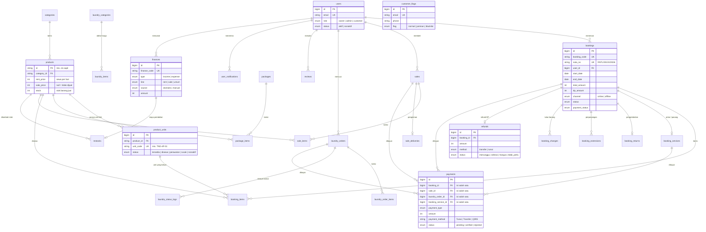

# Struktur Database Annapurna Adventure

Database MySQL dengan 36 tabel aplikasi, dibagi menjadi 8 bagian. Setiap bagian punya satu file migrasi di `database/migrations/`.

| No | Bagian | File migrasi | Tabel |
|---|---|---|---|
| 01 | Akun | `0001_01_01_000000_create_akun_tables` | users, password_reset_tokens, sessions |
| 02 | Katalog | `2026_11_13_000001_create_katalog_tables` | categories, products, product_units, packages, package_items |
| 03 | Sewa | `2026_11_13_000002_create_sewa_tables` | bookings, booking_items, booking_services, booking_returns, booking_extensions, booking_changes, refunds |
| 04 | Penjualan | `2026_11_13_000003_create_penjualan_tables` | sales, sale_items, sale_deliveries |
| 05 | Laundry | `2026_11_13_000004_create_laundry_tables` | laundry_categories, laundry_items, laundry_orders, laundry_order_items, laundry_status_logs |
| 06 | Pembayaran | `2026_11_13_000005_create_payments_table` | payments |
| 07 | Keuangan | `2026_11_13_000006_create_keuangan_tables` | finances, restocks |
| 08 | Sistem | `2026_11_13_000007_create_sistem_tables` | settings, promos, reviews, user_notifications, customer_flags, document_sequences, nota_links, activity_logs, email_logs, chat_misses |

Tabel bawaan Laravel (`cache`, `cache_locks`, `jobs`, `job_batches`, `failed_jobs`, `migrations`) tidak dibahas di sini.

## Diagram relasi (ERD)

Diagram ini tampil sebagai gambar di GitHub dan di VS Code (dengan ekstensi Mermaid). Hanya kolom kunci yang ditampilkan.



## Penjelasan per bagian

### 01 · Akun
- **users** menyimpan semua orang yang memakai sistem. Kolom `role` membedakan owner, admin (staff toko), dan customer.
- Kolom `auto_created` menandai akun customer yang dibuat otomatis saat staff mencatat transaksi di kasir.

### 02 · Katalog
- **products** dipakai untuk barang sewa sekaligus barang jual. ID produk berupa teks (`ck-capit`) dan sama dengan ID di tampilan.
- **product_units** berisi satu baris untuk setiap barang fisik yang disewakan, lengkap dengan kode unit dan kondisinya. Ketersediaan barang sewa dihitung dari tabel ini.
- `products.stock` adalah stok barang jual. Untuk barang sewa, kolom ini hanya dipakai bila produk belum punya unit fisik.
- Harga sewa bertingkat: `rent_price` (per hari), `rent_price_3` (total 3 hari), dan `rent_price_5` (total 5 hari). Paket memakai pola yang sama (`price_per_day`, `price_3`, `price_5`).

### 03 · Sewa
- **bookings** menyimpan data inti satu transaksi sewa. Data customer disalin ke booking, sehingga nota tetap benar meskipun akun berubah.
- **booking_items** berisi barang yang disewa. Nama dan harga juga disalin, sehingga nota lama tidak ikut berubah saat harga katalog berubah.
- **booking_returns** berisi hasil pemeriksaan saat barang kembali. Denda hanya tercatat di sini (`total_fine`) dan sudah ikut ditambahkan ke `bookings.total_amount`.
- **refunds** mencatat pengembalian DP saat booking dibatalkan: jumlah, metode (transfer/tunai), rekening tujuan, dan foto bukti.
- **booking_services** berisi layanan antar/jemput dan pasang tenda. Pembayarannya ada di `payments`, terpisah dari uang sewa.

### 04 · Penjualan
- **sales**, **sale_items**, dan **sale_deliveries** dipakai untuk pembelian barang, baik di kasir maupun online. `sale_items.unit_cost` menyimpan harga modal saat terjual, untuk menghitung laba.

### 05 · Laundry
- Customer tidak memesan laundry lewat website. Halaman laundry di website hanya berisi daftar harga dan kalkulator estimasi, yang membaca `laundry_categories` dan `laundry_items`.
- Staff mencatat pesanan laundry di kasir (`laundry_orders`, nota `DRY/…`). Pembayarannya diterima saat barang diambil dan dicatat di `payments`.

### 06 · Pembayaran
- Semua uang dari customer dicatat di satu tabel **payments**. Setiap baris mengisi tepat satu dari empat kolom pemilik: `booking_id`, `sale_id`, `laundry_order_id`, atau `booking_service_id`.
- Transfer online berstatus `pending` sampai diverifikasi admin. Pembayaran di toko langsung berstatus `verified`, dan `verified_by` diisi staff yang menerima uang.

### 07 · Keuangan
- **finances** adalah buku kas: pemasukan dan pengeluaran per lini usaha (`rent`, `sale`, `umum`). Kolom `source` membedakan baris yang dibuat sistem dari pembayaran/refund (`otomatis`) dan baris yang dicatat staff, misalnya pemasukan lain, listrik, pembelian stok, dan perawatan alat (`manual`). Halaman Keuangan hanya mengambil baris `manual`, karena pemasukan otomatis dihitung dari pesanan, sehingga tidak terhitung dua kali.
- **restocks** mencatat pembelian stok atau unit baru. Biayanya dibukukan sebagai pengeluaran di `finances`.

### 08 · Sistem
- **settings** menyimpan pengaturan toko dalam bentuk kunci dan nilai JSON. Nama kunci selalu snake_case (`dp_percent`, `cancel_days`, `dur_rules`). Kunci camelCase dari tampilan (`dpPercent`) otomatis diarahkan ke baris yang sama.
- **document_sequences** menyimpan nomor urut nota per bulan.
- **activity_logs** mencatat jejak aktivitas staff. Setiap baris menyimpan hash baris sebelumnya, sehingga perubahan diam-diam bisa ketahuan.
- **reviews** menyimpan ulasan customer sekaligus testimoni beranda. Satu ulasan bisa untuk beberapa barang (`product_ids`).
- **user_notifications** berisi notifikasi lonceng per akun. Notifikasi yang sama dan belum dibaca digabung (`count`).
- **customer_flags** menyimpan status pelanggan dari Owner: normal, perlu jaminan tambahan, atau diblokir. Pelanggan yang diblokir ditolak server saat memesan online, baik dicocokkan lewat email maupun nomor HP.

## Mengisi ulang database

```
php artisan migrate:fresh --seed
```

Perintah ini mengisi:
- 3 akun contoh: owner, admin, dan customer.
- Katalog dari `database/seeders/data/katalog.json`: 14 kategori, 91 produk, 485 unit, 11 paket, 3 promo, dan pengaturan toko.
- Daftar harga laundry.
- Satu contoh booking.

Kalau ingin mengubah katalog awal, cukup ubah file JSON tersebut.

## Hubungan dengan tampilan (frontend)

Tampilan buatan Dita menyimpan data di browser (`public/assets/js/data.js`). Sekarang server menjadi sumber kebenarannya:

| Arah | Cara | Isi |
|---|---|---|
| Server → browser | `/boot.js` dimuat setiap halaman, sebelum skrip halaman | pengaturan toko, kategori, barang (tanpa harga modal), paket, promo, ulasan yang tampil |
| Server → browser (staff) | `/boot-staff.js` | harga modal, semua ulasan, status pelanggan, pemasukan/pengeluaran manual, pengaturan khusus Owner |
| Server → browser (akun) | ditulis langsung di layout | notifikasi akun yang sedang masuk |
| Browser → server | `POST /api/sync/{koleksi}` otomatis setiap kali `data.js` menyimpan | barang, kategori, promo, ulasan, pengeluaran, pemasukan, status pelanggan, pengaturan, notifikasi |

Penerjemah bentuk data antara kolom database dan objek tampilan ada di `app/Support/FeData.php`. Aturan siapa boleh mengubah apa ada di `app/Http/Controllers/Annapurna/SyncController.php`:
- Customer hanya boleh menulis ulasannya sendiri dan mengirim notifikasi ke staff.
- Admin boleh mengubah katalog, keuangan manual, dan profil toko.
- Owner boleh mengubah semua pengaturan.

File `boot.js` memakai parameter versi (`?v=`) yang berubah setiap kali data berubah, jadi aman disimpan di cache browser.
